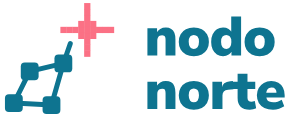
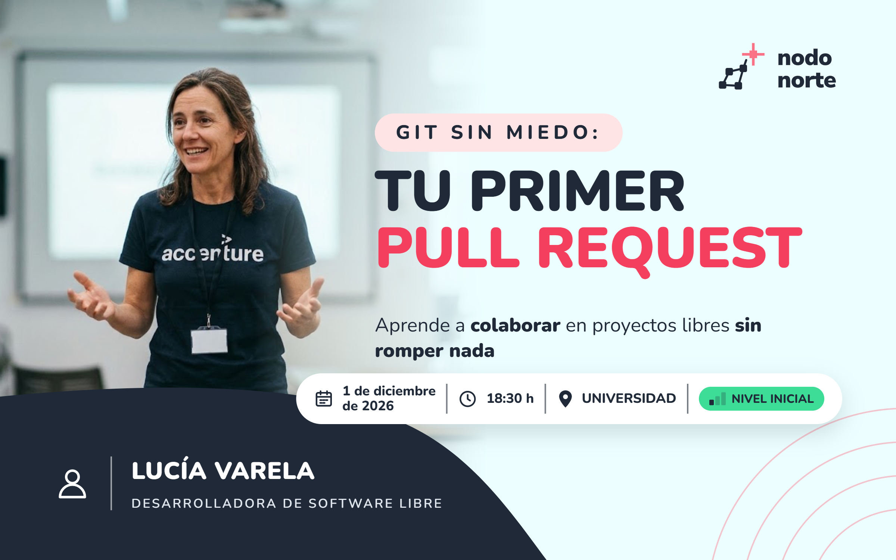
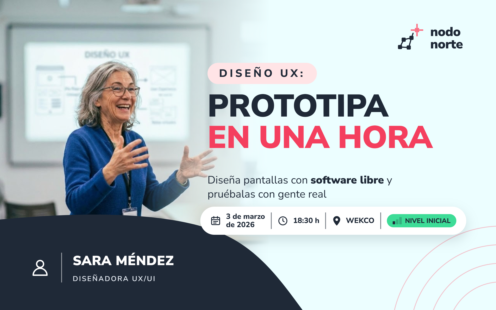
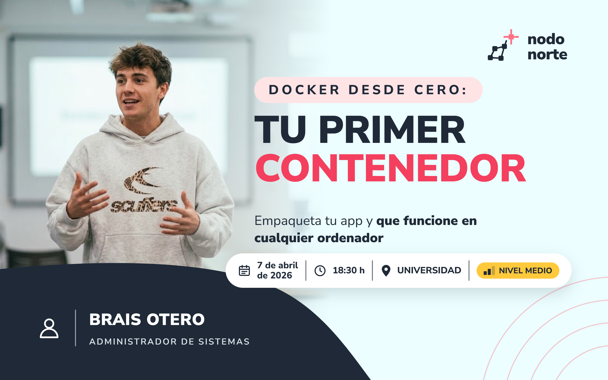
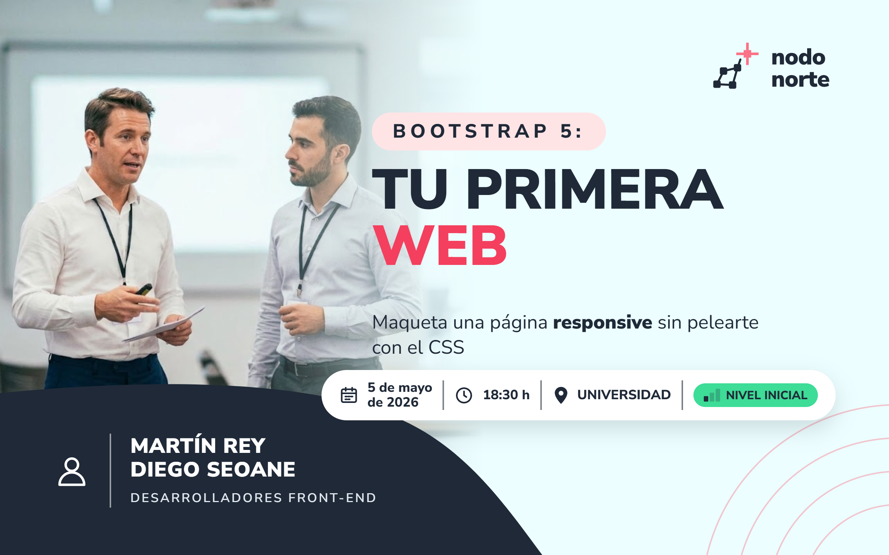
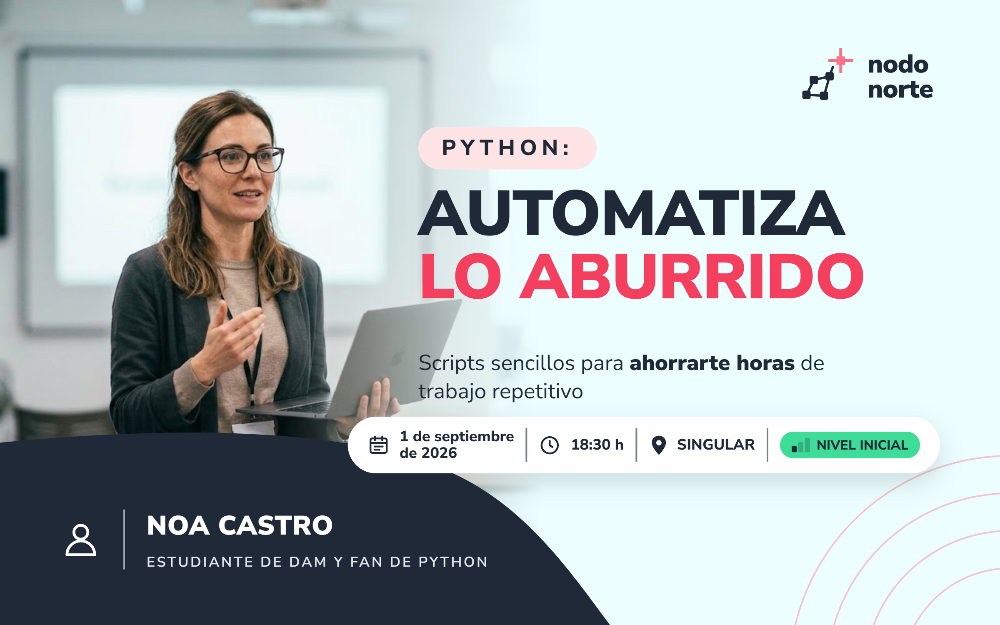
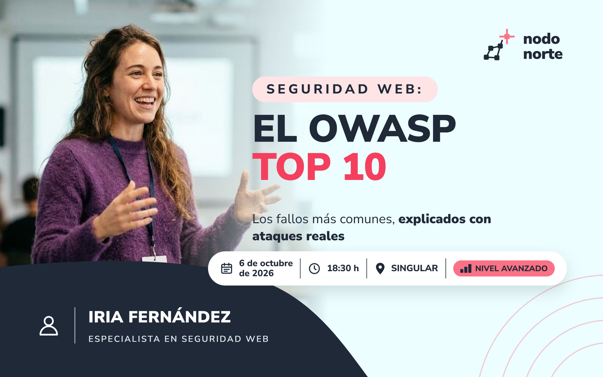
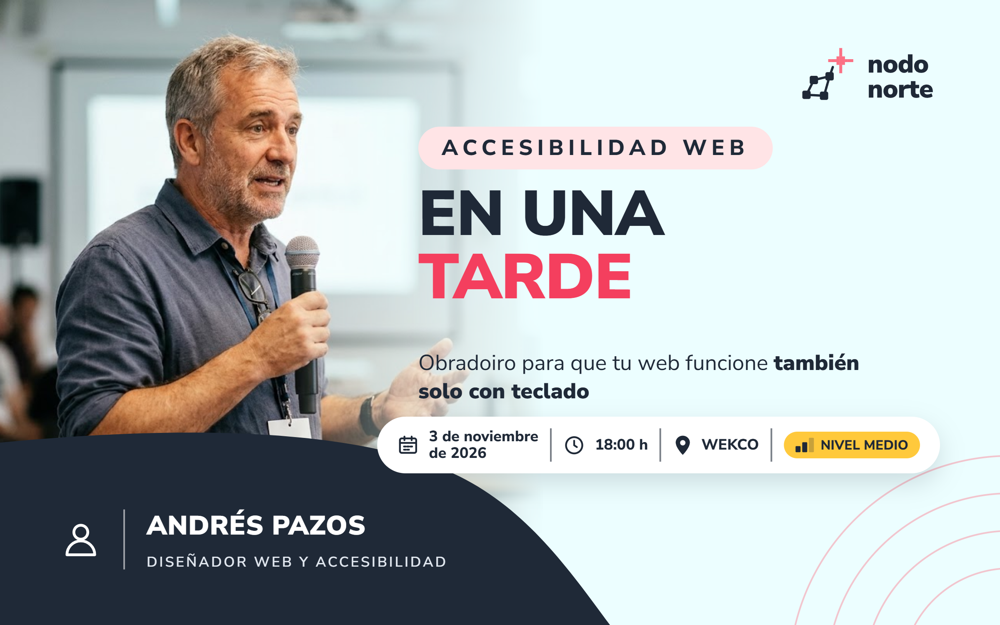

<p align="center">
  
</p>

<h1 align="center">Nodo Norte</h1>

<p align="center">
  Comunidad tecnológica sin ánimo de lucro de A Coruña.<br>
  Charlas, talleres y obradoiros el primer martes de cada mes.
</p>

---

## Índice

1. [Sobre el proyecto](#sobre-el-proyecto)
2. [Autores](#autores)
3. [Objetivo de la web](#objetivo-de-la-web)
4. [Páginas de la web](#páginas-de-la-web)
5. [Eventos](#eventos)
6. [Scrum](#scrum)
7. [Diseño](#diseño)
8. [Estructura de carpetas](#estructura-de-carpetas)
9. [Tecnologías usadas](#tecnologías-usadas)
10. [Estado del proyecto](#estado-del-proyecto)
11. [Cómo ver el proyecto](#cómo-ver-el-proyecto)

## Sobre el proyecto

**Nodo Norte** es una comunidad de estudiantes y profesionales de la zona que se reúne una vez al mes para aprender juntos. Los eventos son el primer martes de cada mes (con algún extra de vez en cuando) en tres sedes: la **Universidad**, **Singular** y **Wekco** (Mesoiro). Después de cada evento hay networking con comida y bebida.

Sus valores son la cercanía, el aprendizaje compartido, el software libre y que nadie se sienta fuera de lugar.

Este repositorio es la práctica de **Diseño de Interfaces Web (DIW)**: diseñar y maquetar con Bootstrap la web de la comunidad, trabajando con Scrum en dos sprints.

## Autores

| Nombre | GitHub |
|---|---|
| Francisco Puñal | [@superfurry-tech](https://github.com/superfurry-tech) |
| Daniel Díaz | [@diaz827](https://github.com/diaz827) |

## Objetivo de la web

Que un estudiante de FP o universidad, de 16 a 35 años, entre en la web desde el móvil y en pocos minutos encuentre el próximo evento y **se apunte**, **se haga socio** o **proponga una charla**.

## Páginas de la web

La web tiene tres páginas. Los formularios no son páginas aparte: se abren como ventanas (modales de Bootstrap) en la misma página donde está su botón, y se validan con JavaScript.

| Página | Archivo | Contenido |
|---|---|---|
| Inicio | `index.html` | Hero «Sobre nosotros», próximo evento, preguntas frecuentes (acordeón) y formulario de inscripción al evento |
| Eventos | `pages/eventos.html` | Próximo evento, formulario de inscripción, calendario y seis eventos anteriores con información y enlaces provisionales a imágenes y diapositivas |
| Únete | `pages/unete.html` | Tarjetas para hacerse socio o proponer una charla, con un formulario para cada una |

### Formularios

| Formulario | Dónde se abre | Campos |
|---|---|---|
| Inscripción a eventos | Inicio y Eventos | Nombre, correo, nivel y si es la primera vez que viene |
| Hacerse socio | Únete | Nombre, apellidos, edad, fecha de nacimiento, DNI, correo y forma de pago (transferencia o PayPal). Cuota voluntaria de 10 €/año, con plaza asegurada en los talleres |
| Proponer una charla | Únete | Tema, nivel, tipo (charla, obradoiro o taller), duración en minutos y descripción |

Todos validan los campos al enviar y, si están bien, muestran un aviso de «Enviado». Los datos no se mandan a ningún servidor: el envío está simulado.

## Eventos

Cada evento tiene su tarjeta en [`img/tarjetas/`](img/tarjetas/), con el nombre `mes_día`. La tarjeta muestra el título, la fecha, la hora, el lugar, el ponente y el nivel.

Los niveles se distinguen por color: **inicial** (verde), **medio** (amarillo) y **avanzado** (rosa).

### Próximo evento

<p align="center">
  
</p>

**Git sin miedo: tu primer pull request**

- **Cuándo:** martes 1 de diciembre de 2026, a las 18:30 h
- **Dónde:** Universidad
- **Ponente:** Lucía Varela, desarrolladora de software libre
- **Nivel:** inicial
- **Aforo:** 60 plazas

### Eventos anteriores

| Fecha | Evento | Ponente | Lugar | Nivel |
|---|---|---|---|---|
| 3 mar 2026 · 18:30 | [Diseño UX: prototipa en una hora](img/tarjetas/marzo_3.png) | Sara Méndez, diseñadora UX/UI | Wekco | Inicial |
| 7 abr 2026 · 18:30 | [Docker desde cero: tu primer contenedor](img/tarjetas/abril_7.png) | Brais Otero, administrador de sistemas | Universidad | Medio |
| 5 may 2026 · 18:30 | [Bootstrap 5: tu primera web](img/tarjetas/mayo_5.png) | Daniel Díaz y Francisco Puñal, estudiantes de DAW | Universidad | Inicial |
| 1 sep 2026 · 18:30 | [Python: automatiza lo aburrido](img/tarjetas/septiembre_1.png) | Noa Castro, estudiante de DAM | Singular | Inicial |
| 6 oct 2026 · 18:30 | [Seguridad web: el OWASP Top 10](img/tarjetas/octubre_6.png) | Iria Fernández, especialista en seguridad web | Singular | Avanzado |
| 3 nov 2026 · 18:00 | [Accesibilidad web en una tarde](img/tarjetas/noviembre_3.png) (obradoiro) | Andrés Pazos, diseñador web y accesibilidad | Wekco | Medio |

<details>
<summary>Ver todas las tarjetas</summary>

<p>
  
  
  
  
  
  
</p>

</details>

## Scrum

| Rol | Quién |
|---|---|
| Product Owner y cliente | Mónica Pérez Sueiro |
| Developers | Francisco Puñal y Daniel Díaz |

| Sprint | Scrum Master | Sprint Goal |
|---|---|---|
| Sprint 1 | Francisco Puñal y Daniel Díaz | Diseño aprobado por el cliente (wireframes, moodboard y guía de estilos) y plantilla base en Bootstrap con navbar y footer en las tres páginas, subida a main. |
| Sprint 2 | Francisco Puñal y Daniel Díaz | Web completa de Nodo Norte, con las tres páginas, los formularios y los componentes, validada, responsive y accesible, lista para entregar. |

**Product Goal:** que un estudiante de FP o universidad entre en la web de Nodo Norte desde el móvil y, en pocos minutos, encuentre el próximo evento y se apunte, se haga socio o proponga una charla.

Al ser un equipo de dos personas, compartimos las tareas de organización y seguimiento y acordamos juntos el reparto del trabajo.

Las fichas de la práctica (información del cliente, páginas y Product Backlog) están en [`docs/fichasPracticas/`](docs/fichasPracticas/).

**Tablero del proyecto (GitHub Projects):** https://diaz827.github.io/NodoNorte

## Diseño

Antes de maquetar se preparó todo el diseño para que lo aprobara el cliente.

| Entregable | Dónde está |
|---|---|
| Moodboard | [`docs/moodboard/moodboard.png`](docs/moodboard/moodboard.png) |
| Wireframes (móvil y escritorio) | [`docs/wireframes/`](docs/wireframes/) |
| Prototipos de Inicio, Eventos y Únete | [`docs/prototipos/`](docs/prototipos/) |
| Guía de estilo web | [`docs/guias-estilos/Guía de estilo web.png`](<docs/guias-estilos/Guía de estilo web.png>) |
| Guía del logo | [`docs/guias-estilos/Guía del logo.png`](<docs/guias-estilos/Guía del logo.png>) |

### Paleta de colores

| Color | Hex | Uso |
|---|---|---|
|  Principal | `#0E7490` | Navbar, footer, títulos y enlaces |
|  Fondo | `#ECFEFF` | Fondo de la página y tarjetas |
|  Acento | `#FB7185` | Botones, con texto `#1F2937` |
|  Secundario | `#F1F5F9` | Secciones alternas |
|  Texto | `#1F2937` | Texto y fondos oscuros |

Colores de nivel: inicial `#3DDC97`, medio `#FFC93C` y avanzado `#FB7185`.

El rosa `#FB7185` nunca se pone sobre el turquesa `#0E7490`, porque el contraste es de solo 1,99:1 y no cumple AA.

### Tipografía

**Nunito Sans**, una fuente redondeada, cercana y muy legible en móvil.

### Logo: «Estrella polar»

Una constelación de nodos con un destello de píxeles rosa que marca el norte, con «nodo» encima de «norte» en turquesa y sin lema.

El paquete está en [`img/logos/`](img/logos/), con fondo transparente, en SVG y PNG, y en versión clara (para fondos claros) y oscura (para fondos oscuros):

| Versión | Uso | Tamaños PNG |
|---|---|---|
| `completo/` | Icono y nombre | 1200, 600, 300 y 150 px |
| `solo-icono/` | Favicon y avatar de redes | 512, 256, 128, 64, 32 y 16 px |
| `solo-nombre/` | Solo el texto «nodo norte» | 1000, 500, 250 y 125 px |

## Estructura de carpetas

Estructura final de la entrega:

```
NodoNorte/
├── index.html
├── pages/
│   ├── eventos.html
│   └── unete.html
├── css/
│   └── estilos.css          CSS propio, solo lo que Bootstrap no cubre
├── js/
│   └── validacion.js        validación de los formularios y aviso de envío
├── img/
│   ├── hero/                imágenes del hero de Inicio (escritorio y móvil)
│   ├── logos/               logo Estrella polar (SVG y PNG)
│   ├── tarjetas/            tarjetas de los eventos
│   └── unete/               imágenes de las tarjetas de Únete
├── docs/
│   ├── fichasPracticas/     fichas de la práctica
│   ├── guias-estilos/       guía de estilo web y guía del logo
│   ├── moodboard/
│   ├── prototipos/
│   └── wireframes/
└── README.md
```

## Tecnologías usadas

| Tecnología | Para qué |
|---|---|
| HTML5 | Estructura semántica: `header`, `nav`, `main`, `section` y `footer` |
| CSS3 | Estilos propios en `css/estilos.css` |
| Bootstrap 5.3 (CDN oficial) | Rejilla responsive y componentes: navbar, cards, acordeón, modales, toasts, formularios, botones y tabla de próximos eventos |
| Bootstrap Icons | Iconos |
| JavaScript | Validación de los formularios y aviso de envío en `js/validacion.js` |
| Git y GitHub | Control de versiones |
| GitHub Projects | Tablero Scrum (Por hacer, En curso, Hecho) |

## Estado del proyecto

- [x] Entrevista con el cliente y fichas
- [x] Moodboard, wireframes y prototipos
- [x] Guía de estilo y guía del logo
- [x] Logo definitivo
- [x] Tarjetas de los eventos
- [x] Páginas de Inicio y Únete con Bootstrap
- [x] Formularios con validación
- [x] Página de Eventos, navbar y footer
- [x] Validación HTML con W3C y comprobaciones responsive y de navegación con teclado
- [x] Revisión del contraste de los colores principales del CSS

## Cómo ver el proyecto

```bash
git clone https://github.com/diaz827/NodoNorte
```

Abre `index.html` en el navegador. No hace falta instalar nada: Bootstrap y Bootstrap Icons se cargan desde el CDN.
